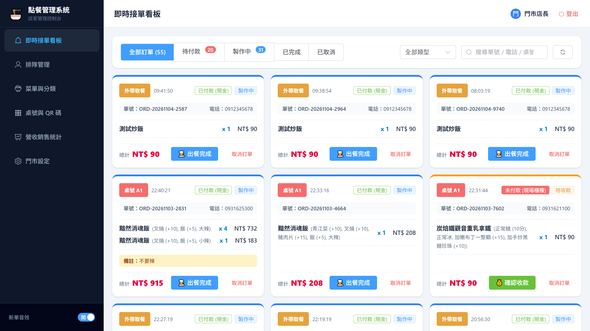
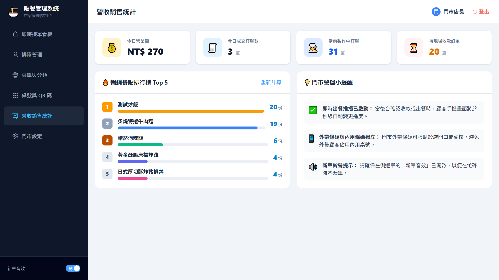
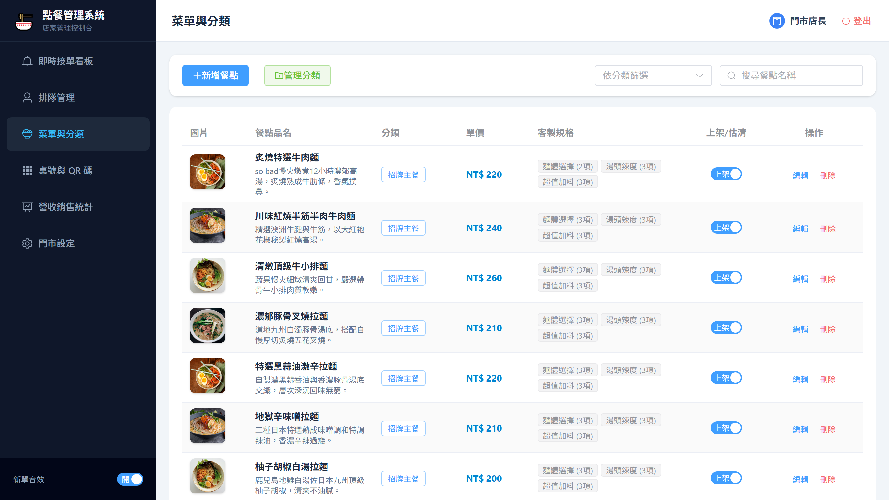
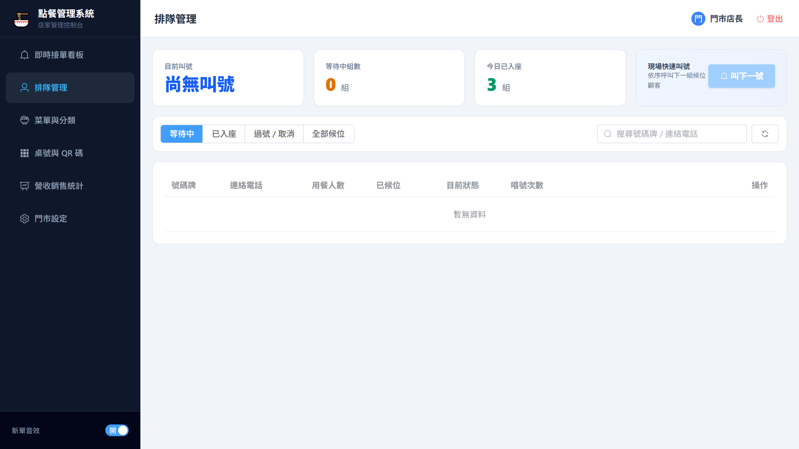

# 💻 QR Dine Admin - 店家營運與排隊叫號管理後台

> 針對餐飲門市打造的全功能桌面端管理後台，涵蓋營運儀表板、即時訂單流轉、菜單規格配置、排隊叫號唱號及門市資訊設定。

---

## 📸 介面畫面展示 (Screenshots)

### 1. 即時接單看板 (Live Orders Workspace)


### 2. 營運數據儀表板 (Dashboard)


### 3. 菜單管理與圖片智能壓縮 (Menu Management)


### 4. 現場排隊叫號看板 (Queue Management)


---

## ✨ 核心特色與功能

- 🍳 **即時訂單工作台**：
  - 新訂單鈴聲推播提醒。
  - 狀態流轉（待付款 ➡️ 烹調中 ➡️ 已完成 ➡️ 已取消）。
  - 現金收款一鍵核銷與防重複收款校驗。
- 📊 **營運即時看板**：即時統計今日營業額、完成訂單數、待確認/烹調中訂單與熱銷餐點排行 Top 5。
- 🥗 **菜單與規格自訂**：
  - 支援多分類、餐點單選/複選規格群組（加辣、加蛋、加麵等）。
  - **圖片智慧壓縮**：前端上傳大於 1MB 圖片時自動啟動 Canvas 壓縮至 1MB 內再傳送，節省儲存與載入頻寬。
  - 一鍵即時切換停售/上架，秒級同步至顧客端手機。
- 📢 **內用排隊唱號系統**：
  - 號碼牌清單（依人數分組、等待時間、手機號碼遮罩去敏）。
  - 叫號推進（唱號 1/3, 2/3, 3/3）、逾期過號自動作廢、安排入座。
- 🏪 **門市與發票設定**：維護門市營業時間、電話地址、統編/載具發票支援開關。

---

## 🛠️ 技術棧 (Tech Stack)

- **核心框架**：Vue 3 (Composition API)
- **程式語言**：TypeScript
- **構建工具**：Vite 8
- **狀態管理**：Pinia
- **UI 元件庫**：Element Plus + Tailwind CSS
- **即時通訊**：Socket.io-client 4.8
- **自動化測試**：Playwright E2E

---

## 🚀 快速開始 (Getting Started)

### 1. 安裝依賴
```bash
npm install
```

### 2. 啟動管理後台服務
```bash
npm run dev
```
瀏覽器開啟：`http://localhost:5174/`

> **預設管理者帳號密碼**：
> * 帳號：`admin`
> * 密碼：`123456`

### 3. 執行測試
```bash
npm test
```

### 4. 正式打包建置
```bash
npm run build
```
